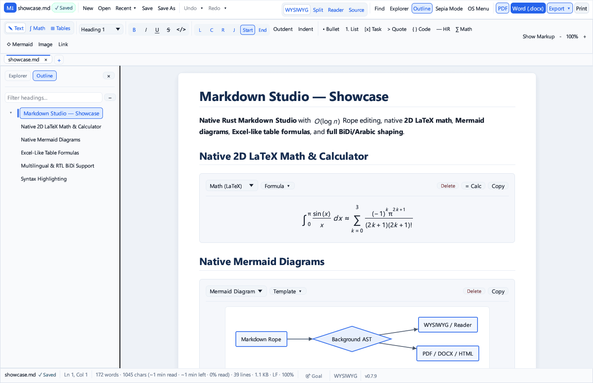
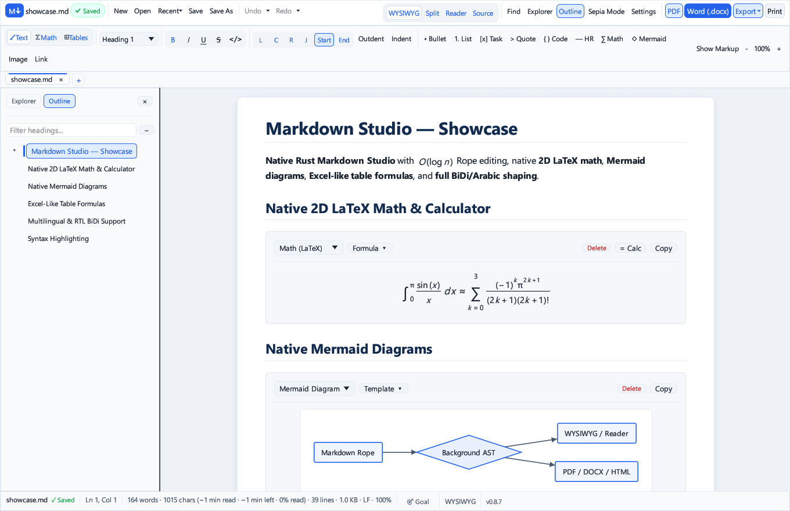
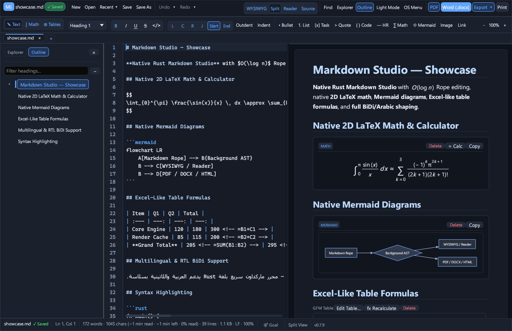
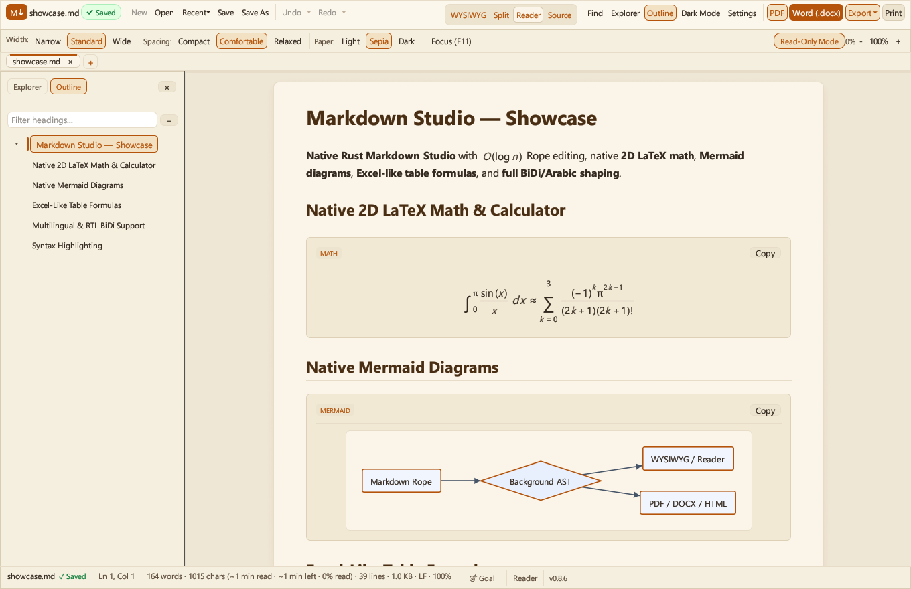

# Markdown Studio

**An ultra-fast, native desktop Markdown reader, WYSIWYG studio editor, and document exporter written in Rust.**

[](LICENSE)
[](https://www.rust-lang.org/)
[](#installation)
[](https://github.com/abdullahgharib/markdown-studio/actions/workflows/ci.yml)

**Current Version:** `0.7.15` (`markdown_studio`)

---

## Why Markdown Studio?

Most modern Markdown editors bundle a full Chromium browser via Electron, consume hundreds of megabytes of RAM, and lag on multi-megabyte documents—or rely on external toolchains (Pandoc, LaTeX, Node.js) for diagrams, math, and exports.

**Markdown Studio** compiles to a single native Rust binary (~21 MB on Windows) powered by `eframe`/`egui`, `ropey`, and `comrak`:

- **No Electron, No Browser Runtime** — instant cold startup, low memory footprint, and smooth 60–120 FPS rendering.
- **Built for Massive Files** — $O(\log n)$ `ropey::Rope` edits, $O(\log B)$ Fenwick-tree viewport virtualization, off-thread AST parsing ($\ge 32\text{ KB}$), and SIMD literal search via `memchr` let you open and edit 10 MB+ Markdown files smoothly.
- **Four Synchronized Modes** — switch seamlessly between **WYSIWYG (`Ctrl+1`)**, **Split (`Ctrl+2`)**, **Reader (`Ctrl+3`)**, and **Source (`Ctrl+4`)**.
- **Native 2D LaTeX Math & Scientific Calculator** — render fractions, roots, matrices, integrals, and aligned equations natively, or click `= Calculate` / `⚡ Auto-Calc` to evaluate expressions and variables in place.
- **Native 6-Type Mermaid Engine** — vector rendering for Flowchart, Sequence, State, Class, ER, and Pie diagrams with zero Node.js/browser dependencies.
- **Excel-Like Table Formulas** — interactive 8×8 table picker, Formula Bar (`SUM`, `AVERAGE`, `MIN`, `MAX`, `COUNT`, `IF`, `A1:B3`, `ABOVE`/`LEFT`/`BELOW`/`RIGHT`), and lossless cached Markdown persistence (`<!-- =FORMULA -->`).
- **First-Class BiDi & Arabic / Persian / Urdu Support** — UAX #9 paragraph direction detection, contextual Arabic/Persian/Urdu shaping, RTL bracket mirroring, and bijective logical-to-visual cursor editing.
- **Rich Media, Lightbox & In-Place WYSIWYG Captions**: Native rendering for local and online (`http://`/`https://`) raster images (PNG, JPEG, WebP, TIFF), **animated GIFs**, and **crisp 2× SVG/SVGZ** graphics — click any image in **Reader Mode** (inline, inside tables, lists, or blockquotes) to open an enlarged **zoomable lightbox** (`50%–400%` / `Esc`), or click any image label in **WYSIWYG Mode** to edit captions in place (`Ctrl+Z` undoable) without switching to Source mode.
- **Zero-Dependency Exports** — export directly to **Vector PDF** (with clickable outline bookmarks, internal `#anchor`/footnote links, and configurable headers/footers), **Word (`.docx`)**, **Standalone HTML5**, **Structured JSON**, or print via OS spoolers.

---

## Screenshots



| WYSIWYG Mode (Light) | Split Mode (Dark) | Reader Mode (Sepia) |
| :---: | :---: | :---: |
|  |  |  |

---

## Feature Highlights

### Workspace & Productivity
- **VS Code / Chrome-Style Multi-Tab Workspace**: Open multiple files, drag tabs to reorder, drag tabs out to spawn new windows, or drop tabs across running Markdown Studio windows (preserving unsaved edits).
- **Single-Instance File Forwarding**: Opening files from your OS file manager or CLI forwards them as new tabs in the active window (`--new-window` / `-n` opens a separate window).
- **File Explorer & Live Outline Sidebars**: Lazy cached directory tree with search and file-type filters (`All`, `MD`, `Text`, `Code`), plus a collapsible, searchable heading Outline with live scroll-spy.
- **Smart Rich-Text & Image Paste (`Ctrl+V`)**: Paste formatted content from websites, Word, Google Docs, or Excel/Sheets directly as clean GFM Markdown, or paste clipboard screenshots straight into `assets/` (`Ctrl+Shift+V` pastes verbatim plain text).
- **Crash-Safe Auto-Recovery & External Diff Detection**: Automatic session snapshots (`session.json` + streaming `recovery/` drafts) and clean auto-reload / visual diff modal when files change on disk.
- **Writing Goals & Reading Time**: Status bar word/character counts, estimated reading time, and configurable writing goal tracker.
- **Three Paper Themes & Comfort Controls**: **Light** (*Classic Paper*), **Sepia** (*Warm Paper*), and **Dark** (*Midnight Studio*), configurable page width and line spacing, `F11` Focus Mode, `Ctrl+Scroll`/Pinch zoom (`60%–200%`), and middle-click two-arrow auto-scroll.

### Publishing & Export
- **Vector PDF**: Paginated PDFs with hierarchical `H1`–`H6` outline bookmarks, clickable URL/`#anchor`/footnote annotations, configurable `{title}`/`{page}`/`{pages}`/`{date}` headers and footers, embedded local images, and high-DPI rasterized Mermaid & 2D math figures.
- **Word (`.docx`)**: Native OpenXML packages with Word Navigation Pane headings, clickable anchors and footnotes, `Cambria Math` inline equations, embedded Mermaid/2D math PNGs, RTL `w:bidi` support, and styled code/table blocks.
- **HTML5 & JSON**: Self-contained responsive HTML5 with sticky outline navigation and base64 assets, plus structured AST/outline/stats JSON.

---

## Keyboard Shortcuts

| Shortcut | Action |
| :--- | :--- |
| `Ctrl+1` / `2` / `3` / `4` | Switch View Mode (WYSIWYG / Split / Reader / Source) |
| `F11` | Toggle distraction-free Focus Mode |
| `Ctrl+N` / `Ctrl+T` / `Ctrl+W` | New untitled tab / Close active tab |
| `Ctrl+Tab` / `Ctrl+Shift+Tab` | Cycle next / previous tab |
| `Ctrl+O` / `Ctrl+S` / `Ctrl+Shift+S` | Open / Save / Save As |
| `Ctrl+P` | Print Settings dialog |
| `Ctrl+Z` / `Ctrl+Y` (`Ctrl+Shift+Z`) | Undo / Redo |
| `Ctrl+V` / `Ctrl+Shift+V` | Smart Rich-Text & Image Paste / Paste Plain Text |
| `Ctrl+B` / `Ctrl+I` / `Ctrl+U` / `Ctrl+K` | Bold / Italic / Underline / Insert Link |
| `Ctrl+F` / `Ctrl+H` / `F3` / `Shift+F3` | Find & Replace / Next & Previous match |
| `Ctrl+=` / `Ctrl+-` / `Ctrl+0` | Zoom In / Zoom Out / Reset (100%) |
| `Ctrl+Scroll` / Trackpad Pinch | Smooth Zoom (`60%–200%`) |
| `Middle-Click` / `Middle-Drag` | Two-arrow smooth auto-scroll |
| `Click` (Reader) / `Ctrl+Click` (Edit) | Open external URLs, relative `.md` files, `#anchor`, or `[^footnote]` |

---

## Installation

### Prebuilt Binaries (Recommended)
Download the latest release for **Windows**, **Linux**, or **macOS** from [GitHub Releases](../../releases).

### Build from Source

Prerequisites: [Rust toolchain](https://rustup.rs/) (stable, edition 2024).

#### Windows
```powershell
git clone https://github.com/abdullahgharib/markdown-studio.git
cd markdown-studio
cargo build --release
# Output: target\release\markdown_studio.exe
```
*(Optional: If Windows SDK `rc.exe` is installed, `build.rs` embeds the app icon and `VERSIONINFO` metadata automatically. You can also register Windows Explorer context menus via the in-app **OS Menu** button under `HKCU\Software\Classes` without admin rights.)*

#### Linux (Ubuntu / Debian)
Install the system libraries required by `eframe`/`egui` and `rfd`, then build:
```bash
sudo apt-get update
sudo apt-get install -y \
  libxcb-render0-dev libxcb-shape0-dev libxcb-xfixes0-dev \
  libxkbcommon-dev libssl-dev libgtk-3-dev libatk1.0-dev \
  libgdk-pixbuf-2.0-dev libpango1.0-dev libcairo2-dev fonts-dejavu-core fonts-liberation

cargo build --release
# Output: target/release/markdown_studio
```

#### macOS
Ensure Xcode Command Line Tools (`xcode-select --install`) are installed, then build:
```bash
cargo build --release
# Output: target/release/markdown_studio
```

---

## Documentation & Internals

- **[ARCHITECTURE.md](ARCHITECTURE.md)** — System architecture diagram, core performance invariants, module map, settings schema, environment variables, and Criterion benchmark results.
- **[changelog.md](changelog.md)** — Full version history (`v0.1.0` through `v0.7.15`).
- **[CONTRIBUTING.md](CONTRIBUTING.md)** — Development setup, testing commands, and pull request guidelines.

---

## Contributing

Contributions are welcome! Please read [CONTRIBUTING.md](CONTRIBUTING.md) before opening a pull request, or use our [Bug Report](.github/ISSUE_TEMPLATE/bug_report.md) and [Feature Request](.github/ISSUE_TEMPLATE/feature_request.md) templates.

---

## License

Markdown Studio is free and open-source software licensed under the **GNU Affero General Public License v3.0 or later (`AGPL-3.0-or-later`)**. See [LICENSE](LICENSE) for the full license text.
